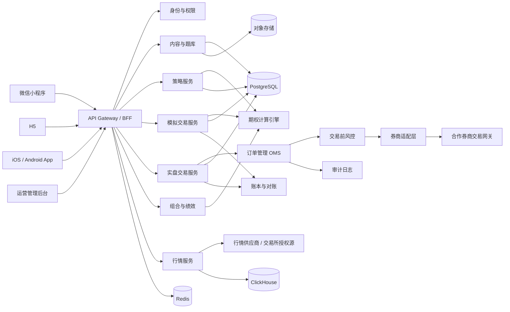
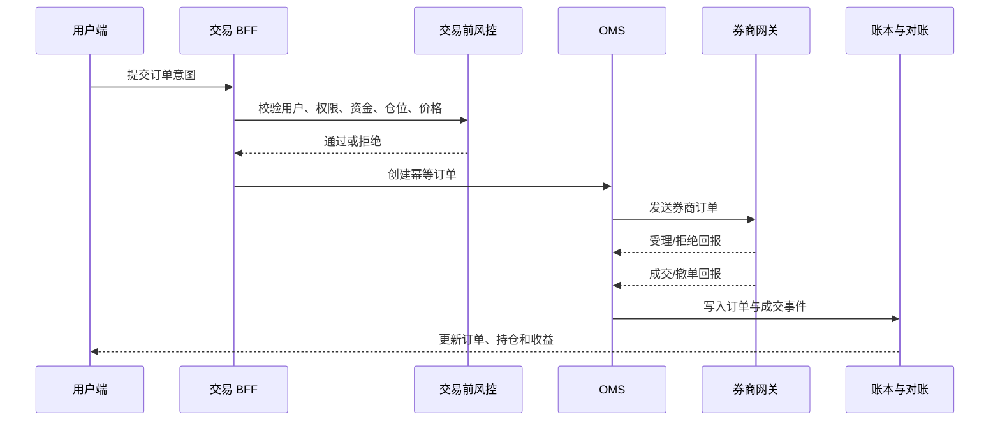

# 期权投资学习与模拟平台设计方案

> 版本：v0.1
> 日期：2026-10-25
> 适用范围：微信小程序、H5、iOS/Android App
> 默认市场假设：境内 ETF 期权为主，后续可扩展商品期权和境外期权
> 说明：本文是产品与技术方案，不构成法律、合规或投资建议。涉及证券业务、行情授权、程序化交易和小程序/App 上架的要求，须由境内律师、券商合规及交易所规则做最终确认。

## 1. 方案结论

产品定位建议为“期权学习 + 策略研究 + 模拟交易”，实盘交易通过持牌券商合作接入，而不是由平台自行保管资金、代客交易或收集券商账号密码。

整体采用“一套核心、三个端壳”的方式建设：

- 一套共享领域模型、期权计算引擎、API SDK 和设计系统。
- 小程序、H5、App 共用业务逻辑，图表和部分原生能力分别适配。
- MVP 先做科普、策略计算器、情景模拟和模拟交易。
- 实盘按“只读账户同步 -> 手工小额下单 -> 完整交易能力”三阶段推进。
- 行情、交易、账户三类数据分别取得授权，不能用非授权爬取或界面自动化替代正式接口。

推荐技术路线：

| 层 | 推荐方案 |
| --- | --- |
| 跨端前端 | uni-app + Vue 3 + TypeScript |
| H5/App 图表 | Apache ECharts 或 TradingView Lightweight Charts |
| 小程序图表 | ECharts 小程序适配版，或基于 Canvas 2D 的轻量图表组件 |
| 后端 | NestJS + TypeScript 模块化单体 |
| 数据库 | PostgreSQL |
| 缓存与任务 | Redis |
| 行情与时序数据 | ClickHouse；早期可用 PostgreSQL 分区表过渡 |
| 内部事件与异步任务 | Redis Streams 或 NATS；规模上来后再引入 Kafka |
| 文件与内容 | 对象存储 + CDN |
| 运维 | Docker、Terraform、CI/CD、集中日志、指标与告警 |

不建议第一版直接拆成大量微服务。期权计算、交易和行情可以做成边界清晰的模块，但先部署为一个模块化单体，配合独立行情采集进程和后台任务进程。等撮合量、行情吞吐或团队规模真正需要时再拆分。

## 2. 产品范围与原则

### 2.1 核心用户旅程

1. 用户阅读期权基础内容，理解合约、权利金、行权价、到期日和盈亏结构。
2. 用户通过交互式损益图和 Greeks 演示理解风险。
3. 用户选择策略模板，调整标的、行权价、到期日和仓位。
4. 用户在情景分析中查看标的涨跌、波动率变化和时间流逝对组合的影响。
5. 用户在模拟账户中下单、持仓、平仓并查看收益和风险指标。
6. 满足适当性条件的用户，通过合作券商完成实盘开户和授权。
7. 用户只读同步实盘账户；试运行稳定后，再开放手工小额下单。

### 2.2 产品边界

- 科普内容必须标注资料来源、更新时间和风险提示。
- 策略模板属于教育和分析工具，不默认构成个性化投资建议。
- 不展示“稳赚”“胜率保证”“跟单保收益”等表述。
- 模拟收益必须与实盘收益明确区分，不能混用统计口径。
- 未取得相应资质前，不做代客理财、代客下单、资金归集或收益承诺。
- 不要求用户输入券商登录密码，不通过模拟点击券商 App 的方式下单。

### 2.3 信息架构

底部导航建议保持五项：

| 导航 | 主要内容 |
| --- | --- |
| 首页 | 学习进度、行情摘要、策略入口、模拟账户概览 |
| 学习 | 基础课程、进阶课程、术语库、测验 |
| 策略 | 策略模板、策略构建器、损益图、情景分析 |
| 实战 | 模拟账户、期权链、下单、持仓、成交、收益 |
| 我的 | 风险测评、账户与券商连接、设置、帮助与披露 |

后台需要独立的管理端，承载内容、题库、合约主数据、行情源、用户、风控、人工审核和运营配置。

## 3. 功能设计

### 3.1 科普板块

目标是让没有期权基础的用户建立完整概念，而不是堆砌文章。

建议课程地图：

| 章节 | 核心内容 | 交互组件 |
| --- | --- | --- |
| 期权入门 | 认购/认沽、买方/卖方、合约要素、到期日 | 合约卡片、买方卖方对照 |
| 价格构成 | 内在价值、时间价值、权利金、隐含波动率 | 权利金拆解滑杆 |
| 盈亏结构 | 到期损益、盈亏平衡点、最大盈亏 | 可拖动损益图 |
| 风险指标 | Delta、Gamma、Theta、Vega、Rho | Greeks 曲线和情景开关 |
| 交易规则 | 保证金、行权、交收、涨跌停、交易时间 | 合约规则查询器 |
| 风险案例 | 卖方尾部风险、流动性风险、波动率风险 | 历史情景复盘 |

每个知识点应包含：

- 一段可独立理解的核心解释。
- 一个可操作的交互示例。
- 一个真实但脱敏的合约案例。
- 一个 3 至 5 题的小测。
- 风险提示和内容更新时间。
- 引用来源或规则依据。

内容生产建议使用结构化内容模型，而不是直接在富文本里写死所有交互。题目、术语、课程、公式、图表参数和提示文案都应可配置、可版本化。

### 3.2 进阶板块

进阶板块由“策略库”和“策略实验室”组成。

首批策略模板：

| 类型 | 策略 |
| --- | --- |
| 方向性 | 买入认购、买入认沽、牛市价差、熊市价差 |
| 波动率 | 买入跨式、买入宽跨式、卖出跨式、卖出宽跨式 |
| 收益增强 | 备兑开仓、现金担保认沽 |
| 保护性 | 保护性认沽、领口策略 |
| 组合策略 | 蝶式、铁鹰式、日历价差、对角价差 |

策略实验室需要具备：

- 多腿编辑：买入/卖出、认购/认沽、数量、行权价、到期日。
- 标的与合约选择：支持按流动性、平值距离、到期日筛选。
- 到期损益图：标记当前标的价格、行权价、盈亏平衡点、最大盈利和最大亏损。
- 当前价值曲线：展示到期前不同标的价格下的理论价值。
- 组合 Greeks：Delta、Gamma、Theta、Vega、Rho 的净敞口。
- 情景矩阵：标的价格变化 × 隐含波动率变化。
- 时间衰减：今天、7 天后、14 天后、到期日。
- 保证金估算：明确区分交易所规则、券商规则和估算值。
- 流动性与风险提示：买卖价差、成交量、持仓量、临近到期风险。
- 保存与分享：保存为个人策略，分享时隐藏账户敏感信息。

策略计算必须同时展示“到期损益”和“当前理论价值”，不能只展示一条容易误导的盈利曲线。

### 3.3 实战板块

实战板块分为三种能力，建议按顺序建设：

| 能力 | 定义 | MVP 是否包含 |
| --- | --- | --- |
| 即时情景模拟 | 不产生订单，基于当前或历史快照计算组合盈亏 | 是 |
| 模拟交易 | 使用模拟资金和模拟订单，按规则成交并结算 | 是 |
| 历史回测 | 用历史行情自动执行策略并统计绩效 | 第二阶段 |

模拟账户需要支持：

- 初始资金、入金/出金、可用资金、冻结资金、保证金占用。
- 标的多头/空头持仓，以及期权多头/空头持仓。
- 限价单、市价单、撤单、部分成交。
- 手续费、滑点、成交量和盘口约束。
- 到期处理、行权处理、合约摘牌。
- 按标的、期权和券商规则配置 T+0/T+1 的可交易数量与资金可用规则。
- 每日盯市、结算、权益曲线和交易流水。
- 订单、成交、持仓、资金四类记录的定期对账。

模拟收益页面建议展示：

- 总权益、累计收益、当日收益。
- 已实现和未实现盈亏。
- 最大回撤、年化波动率、夏普比率、胜率。
- Delta、Gamma、Theta、Vega 净敞口。
- 保证金使用率和集中度。
- 交易次数、手续费和滑点成本。
- 收益归因：标的涨跌、波动率变化、时间衰减、交易成本。

排行榜只作为模拟练习工具。若上线，应默认使用收益率、风险调整收益和样本量组合展示，避免仅按短期收益率诱导交易。

### 3.4 行情的展示边界

所有行情必须显示数据来源、时间戳和状态：

- 实时。
- 延迟 15 分钟。
- 收盘快照。
- 模拟行情。

小程序、H5 和 App 页面都需要有明确的状态标识，不能让用户误把延迟价格当作可交易实时价格。

## 4. 关键用户流程

### 4.1 从学习到模拟交易

1. 用户完成基础课程和风险测验。
2. 用户完成风险承受能力问卷。
3. 用户进入模拟账户并选择初始资金。
4. 用户选择合约或策略模板。
5. 系统给出订单预览、保证金估算和最大风险提示。
6. 用户二次确认后提交模拟订单。
7. 系统按行情和成交模型撮合。
8. 用户查看持仓、情景分析和逐日收益。

### 4.2 策略构建流程

1. 选择标的和观察方向。
2. 选择策略模板或空白组合。
3. 添加多条期权腿。
4. 选择到期日和行权价。
5. 输入数量并校验保证金。
6. 查看损益图、Greeks 和情景矩阵。
7. 保存策略，或发送到模拟订单。

### 4.3 实盘交易流程

1. 用户通过合作券商完成开户和适当性审核。
2. 用户从券商授权页返回平台，平台取得受限交易令牌。
3. 用户同步资金、持仓和订单，默认只读。
4. 用户选择一个策略，进入订单检查页。
5. 系统执行交易前风控检查。
6. 用户输入交易确认信息并完成二次确认。
7. 订单意图发送至券商交易网关。
8. 系统接收订单回执、成交回报和撤单回报。
9. 系统与券商账户定时对账。
10. 异常时冻结下单，展示人工处理入口。

## 5. 技术架构

### 5.1 总体架构



### 5.2 前端工程

建议使用 pnpm workspace：

```text
apps/
  miniapp/        微信小程序
  h5/             H5
  app/            iOS/Android 壳
  admin/          运营与内容后台
packages/
  domain/         纯 TypeScript 领域模型
  option-engine/  BSM、Greeks、IV、损益计算
  api-client/     API SDK 与类型
  ui/             跨端组件和设计令牌
  charts/         图表适配层
  config/         lint、构建和环境配置
services/
  api/            模块化单体后端
  market-worker/  行情采集、清洗、快照
  quant-worker/   批量计算、回测、结算
```

`packages/domain` 和 `packages/option-engine` 不能依赖 DOM、小程序 API 或具体网络库，保证能在 H5、小程序、App 和服务端复用。

小程序端需要关注：

- 主包体积和分包。
- Canvas 2D 绘制性能和像素比。
- WebSocket 生命周期、前后台切换和断线重连。
- 页面返回、分享和登录态的差异。
- 隐私协议、用户信息授权和域名白名单。

App 端使用 uni-app 统一构建 iOS/Android 原生壳，核心业务由跨端层承载，推送、生物识别和安全存储使用原生插件。避免只套一个纯 WebView 壳，否则会带来审核、性能和系统能力受限的风险。

### 5.3 后端工程

第一版采用模块化单体，核心模块：

| 模块 | 职责 |
| --- | --- |
| Identity | 登录、用户、设备、会话、权限 |
| Content | 课程、术语、题库、学习进度、版本 |
| Contract | 标的、期权合约、交易规则、交易日历 |
| Market | 行情接入、清洗、快照、订阅和推送 |
| Strategy | 策略模板、用户策略、组合校验 |
| Quant | 定价、Greeks、IV、损益、情景分析 |
| Paper Account | 模拟资金、订单、成交、持仓、结算 |
| Live Account | 券商授权、账户同步、订单、回报、对账 |
| Portfolio | 组合权益、收益归因、绩效指标 |
| Risk | 适当性、交易前风控、限额、熔断 |
| Admin | 内容审核、用户管理、数据修复、运营配置 |
| Audit | 操作日志、交易日志、安全审计 |

实盘订单模块与模拟订单模块共享订单状态模型，但使用不同的账本、数据表和环境配置。模拟环境不得直接复用实盘密钥或交易通道。

### 5.4 数据存储

PostgreSQL 保存强一致业务数据：

- 用户、身份、权限、风险测评。
- 课程、题库、学习进度。
- 合约主数据和规则版本。
- 模拟账户、订单、成交、持仓、资金流水。
- 实盘账户绑定、订单映射、对账记录。
- 策略模板和用户策略。

ClickHouse 保存大体量时序数据：

- 行情快照和逐笔数据。
- Greeks 快照。
- 组合估值快照。
- 回测结果。
- 运营分析事件。

Redis 保存：

- 会话、限流、幂等键。
- 实时行情订阅状态。
- 短期热点数据。
- 异步任务状态。

对象存储保存课程图片、视频、PDF、导出报告和审计归档。

金额、保证金和权利金统一使用定点数或 Decimal，不使用浮点数作为最终账务值。时间统一保存 UTC，展示时转换为交易所时区。

### 5.5 行情链路

```text
授权行情源
  -> 行情适配器
  -> 标准化合约与报价
  -> 数据质量检查
  -> 快照/逐笔存储
  -> 实时推送
  -> 前端订阅
```

行情适配器需要处理：

- 交易时段和休市状态。
- 重复包、乱序包、缺失包。
- 合约代码映射。
- 买卖盘口和成交量单位。
- 行情源切换和降级。
- 实时、延迟、收盘数据的来源标记。

实时行情对外提供需要合法授权。采购行情源时，应明确用户范围、展示端、是否允许缓存、是否允许二次分发、是否允许用于模拟成交和回测。

## 6. 期权计算与模拟引擎

### 6.1 定价模型

境内 ETF 期权通常可使用带分红收益率的 Black-Scholes-Merton 模型作为基础：

- 标的价格 `S`。
- 行权价 `K`。
- 剩余期限 `T`。
- 无风险利率 `r`。
- 分红或持有收益率 `q`。
- 隐含波动率 `sigma`。

需要输出：

- 理论价格。
- Delta、Gamma、Theta、Vega、Rho。
- 隐含波动率。
- 内在价值和时间价值。
- 组合净 Greeks。

模型必须通过合约主数据配置乘数、最小价格变动、行权方式和结算方式，不能在代码中写死单一市场的规则。

前端计算用于交互预览，服务端计算作为模拟成交、结算和风险指标的权威结果。两端必须使用同一组黄金测试用例，防止预览值与最终账务值不一致。

### 6.2 模拟撮合

模拟撮合不应简单按最新价成交。建议至少实现：

- 限价单只有在价格可成交时成交。
- 市价单按盘口和滑点模型成交。
- 无行情、无流动性或超出价格限制时拒绝。
- 部分成交和剩余撤单。
- 手续费、交易所费用和券商佣金可配置。
- 保证金按合约规则和券商规则估算。
- 临期、停牌、涨跌停和异常行情处理。
- 订单、成交、持仓和资金流水可重放。

模拟账户建议采用事件驱动和不可变流水：

```text
订单意图 -> 风控通过 -> 订单创建 -> 成交事件
-> 持仓变更 -> 资金变动 -> 每日盯市 -> 对账
```

账户余额不能直接覆盖更新，而应由资金流水汇总得到。这样便于排查错误、补数据和生成审计报告。

### 6.3 策略组合计算

组合层需要支持：

- 多腿、多到期日、多标的。
- 到期损益。
- 当前理论价值。
- 情景价格变化。
- 隐含波动率变化。
- 时间流逝。
- 组合保证金。
- 最大亏损、最大盈利和盈亏平衡点。

对于卖方策略，必须明确标识“理论最大亏损可能很大或无限”。对于多腿策略，需要处理不同到期日和提前平仓的风险。保证金估算结果要标注“估算”，并与券商实际占用区分。

### 6.4 收益与风险指标

建议统一定义：

- 累计收益率。
- 年化收益率。
- 最大回撤。
- 年化波动率。
- 夏普比率。
- 索提诺比率。
- 胜率和盈亏比。
- 手续费与滑点占比。
- 保证金使用率。
- 组合 Greeks 敞口。
- 收益归因。

所有指标需要记录计算口径、样本区间和是否包含手续费。模拟和实盘不能直接混合排名。

## 7. 实盘接入要求与方案

### 7.1 先明确业务模式

实盘能力有三种模式，建议按风险从低到高推进。

| 模式 | 能力 | 平台责任 | 建议阶段 |
| --- | --- | --- | --- |
| A. 导流与参数传递 | 生成策略参数，跳转券商交易入口 | 不接触账户和订单 | 第一版可考虑 |
| B. 只读账户同步 | 同步资金、持仓、订单和收益 | 需要券商授权和数据安全 | 实盘试点 |
| C. 实盘下单 | 平台发起订单，券商执行 | 需要完整交易和风控体系 | 后置 |

境内零售证券期权通常没有面向所有开发者的统一公开下单 API。具体能否接入、允许接入哪些客户、使用何种协议，取决于合作券商、交易所规则和客户类型。不能假设 CTP 可以直接覆盖境内 ETF 期权，也不能通过抓包、模拟点击或保存用户密码绕过正式授权。

### 7.2 业务与合规前置条件

上线实盘前至少确认：

- 平台主体是否需要证券业务相关牌照，或是否仅作为技术服务商。
- 与持牌券商签署明确的技术服务、客户服务、数据使用和责任边界协议。
- 用户已在合作券商完成开户、适当性评估、风险揭示和交易权限开通。
- 用户明确授权平台读取账户或发起交易，并可以随时撤销。
- 提供投资建议、策略推荐、组合诊断或自动跟单时，是否触发投资咨询资质要求。
- 程序化交易、算法交易和外部接入的报备要求。
- 实时行情的交易所/供应商授权范围。
- 小程序、H5、App 的金融类目、备案、隐私政策和上架资质。
- 网络安全等级保护、数据出境、个人信息保护和日志留存要求。
- 营销话术、排行榜、收益展示和用户教育内容是否构成不当宣传。

微信小程序对金融类目和交易能力有更严格的审核要求。即使后续具备实盘能力，也应保留独立 App、H5 或合作券商客户端作为交易承接入口，不能把小程序的审核结果视为实盘交易牌照。

### 7.3 券商接入技术条件

券商侧需要提供或确认：

- 正式交易 API、测试环境和接口文档。
- 行情接口和交易接口是否分离。
- 认证方式：OAuth、令牌、证书、FIX、专线或其他方式。
- 静态 IP、白名单、专线和网络接入要求。
- 订单、成交、撤单、持仓、资金和行权相关接口。
- 订单幂等规则、错误码和重试语义。
- 限流、最大订单量、价格校验和交易时段。
- 模拟撮合环境和验收用例。
- 交易回报是推送、轮询还是混合模式。
- 券商侧风控、客户适当性和程序化交易标识要求。

### 7.4 交易系统架构



实盘系统必须满足：

- 前端不能直接调用券商接口。
- 不在日志、数据库明文中保存券商密码。
- 交易令牌使用独立密钥管理服务，按最小权限和最短有效期管理。
- 每笔订单使用客户端订单号和服务端幂等键。
- 明确订单状态机，禁止非法状态跳转。
- 对订单、成交、撤单、持仓和资金进行定时对账。
- 提供全局停单、单用户停单和单策略停单。
- 行情过期、连接断开或回报延迟时自动拒绝下单。
- 市价单默认不做无限自动重试，防止重复成交。
- 实盘和模拟环境物理或逻辑隔离。
- 所有交易动作有不可篡改审计记录。

### 7.5 交易前风控

建议至少包含：

| 检查 | 说明 |
| --- | --- |
| 身份与权限 | 账户状态、交易权限、授权是否有效 |
| 适当性 | 风险等级、期权权限、产品范围 |
| 交易时段 | 是否处于可交易时段 |
| 合约状态 | 是否有效、停牌、临近到期或已摘牌 |
| 价格 | 涨跌停、最小变动价位、异常价格 |
| 数量 | 单笔、单日、单策略、单用户限额 |
| 资金 | 可用资金、保证金、费用 |
| 仓位 | 集中度、裸卖空风险、组合敞口 |
| 行情 | 行情时间戳、断线、买卖盘缺失 |
| 重复交易 | 幂等键、重复点击、短时重复订单 |
| 日内损失 | 单日亏损阈值和自动停单 |
| 人工确认 | 高金额、裸卖、跨期组合等二次确认 |

期权多腿交易要特别处理“部分成交”和“单腿失败”。当券商不支持原子组合订单时，系统需要明确展示执行顺序、失败后的补腿或撤腿方案，不能静默留下意外裸露风险。

### 7.6 实时性与高可用目标

建议目标而不是对券商的硬承诺：

- 行情展示延迟：按授权等级设置目标，页面始终显示时间戳。
- 交易 API 自身 P99：小于 500 毫秒，不含券商和交易所处理时间。
- 订单状态可见延迟：通常小于 1 秒。
- 核心服务可用性：99.95%。
- 订单与账本：RPO 小于 1 分钟，RTO 小于 30 分钟。
- 具备跨可用区部署、数据库备份、演练和事故回滚流程。

### 7.7 实盘上线闸门

上线前应完成：

1. 券商测试环境全流程验收。
2. 模拟、只读、小额实盘三阶段试运行。
3. 订单重复、断网、迟到回报、部分成交和券商超时演练。
4. 资金与持仓对账差异演练。
5. 全局停单和人工接管演练。
6. 安全渗透测试和密钥管理审计。
7. 内容、营销和交易功能合规复核。
8. 用户协议、风险揭示、隐私政策和授权撤回流程上线。
9. 客诉、异常交易和事故响应机制上线。

未通过以上闸门时，只开放学习、分析和模拟功能。

## 8. 数据模型

建议核心实体：

```text
User
Identity
RiskProfile
Course
Lesson
Quiz
LearningProgress

Underlying
OptionContract
TradingCalendar
ContractRuleVersion
MarketQuote
OptionChainSnapshot
GreeksSnapshot

StrategyTemplate
UserStrategy
StrategyLeg
ScenarioResult

PaperAccount
PaperOrder
PaperFill
PaperPosition
CashLedger
MarginSnapshot
DailySettlement

BrokerConnection
LiveAccount
LiveOrder
LiveFill
ReconciliationRecord
RiskCheckRecord
AuditEvent
```

关键约束：

- 合约代码、交易规则和费用规则必须版本化。
- 历史策略引用的合约版本不能被后续主数据更新破坏。
- 账户权益由流水和估值快照推导。
- 订单、成交、资金记录使用唯一业务键。
- 所有行情数据记录来源、时间和是否延迟。
- 用户删除或注销时，依法保留必要的交易审计数据，并隔离其他个人信息。

## 9. 界面与视觉方向

产品应呈现为专业、克制、可反复使用的工具，而不是营销落地页。

设计原则：

- 首页第一屏直接呈现学习进度、模拟账户和行情摘要。
- 采用“红涨绿跌”的境内市场默认配色，并提供色觉友好模式。
- 损益图是策略页的视觉中心，图例、行权价、盈亏平衡点和当前价不可遮挡。
- 工具操作优先使用图标加文字，撤销、撤销订单、缩放、保存等使用明确图标。
- 卡片只用于策略、课程、合约和持仓等独立对象，不作为整页容器。
- 数字使用等宽数字样式，金额、百分比和 Greeks 对齐展示。
- 关键风险使用高对比警示条，但避免大面积红色制造恐慌。
- 所有图表支持长按或点击查看具体数值。
- 移动端优先，H5 在平板和桌面端保持相同信息结构并扩大图表区域。

建议的核心页面：

| 页面 | 主要组件 |
| --- | --- |
| 学习首页 | 课程路径、继续学习、每日一题 |
| 课程详情 | 图文内容、交互示例、测验、来源 |
| 策略库 | 策略分类、风险标签、示例图 |
| 策略实验室 | 多腿编辑器、损益图、Greeks、情景矩阵 |
| 期权链 | 到期日、行权价、认购/认沽、成交量、持仓量 |
| 模拟下单 | 盘口、价格、数量、保证金、最大风险、确认 |
| 模拟账户 | 权益曲线、持仓、订单、成交、收益归因 |
| 账户连接 | 券商授权、只读状态、权限范围、撤销授权 |
| 我的 | 风险测评、学习记录、设置、披露 |

## 10. 安全、隐私与合规设计

### 10.1 账户与数据

- 支持手机号和微信登录，必要时支持 Apple 登录。
- 访问令牌短时有效，刷新令牌可撤销。
- 设备级会话管理和异常登录提醒。
- 敏感字段加密存储，展示时脱敏。
- 最小化采集个人信息，不采集与业务无关的通讯录、定位和生物信息。
- 提供账户注销、授权撤回、数据导出和隐私请求流程。

### 10.2 权限与审计

- 后台使用基于角色的权限控制。
- 内容发布、合约主数据修改、账户解冻、订单停单等高风险操作需要双人复核。
- 交易操作和后台敏感操作写入独立审计日志。
- 审计日志设置只追加、访问控制和保留策略。

### 10.3 安全基础设施

- WAF、DDoS 防护、API 限流和防重放。
- 密钥托管在专用密钥管理服务。
- 数据库和备份加密。
- 依赖漏洞扫描、镜像扫描和供应链安全。
- 定期渗透测试和灾备演练。
- 生产、预发、测试环境隔离。

## 11. 部署与运维

### 11.1 部署拓扑

- H5 和静态资源通过 CDN 分发。
- API 服务部署在境内云厂商的多可用区。
- PostgreSQL 使用主备和定期备份。
- Redis 使用高可用实例。
- ClickHouse 用于行情和分析数据，定期清理原始高频数据。
- 后台任务和行情采集独立部署，避免影响交易 API。
- 日志、指标和链路追踪集中采集。

### 11.2 环境

| 环境 | 用途 | 数据 |
| --- | --- | --- |
| dev | 日常开发 | 合成数据 |
| test | 自动化测试 | 固定测试数据 |
| uat | 券商联调和验收 | 券商模拟账户 |
| staging | 上线前回归 | 脱敏数据 |
| prod | 正式环境 | 生产数据 |

### 11.3 监控

重点监控：

- 行情延迟、缺包率和断线次数。
- API 成功率、P95/P99 延迟和错误率。
- 订单受理率、拒绝率、回报延迟和对账差异。
- 期权计算失败率。
- 模拟结算任务是否按时完成。
- 内容发布和题库异常。
- 登录、授权、密钥和权限异常。

交易类告警必须有明确的升级路径和值守责任人。

## 12. 分阶段路线图

### 阶段 0：定义与验证（约 2 周）

- 确认市场范围、用户画像和商业模式。
- 完成合规预审和券商合作可行性访谈。
- 确认行情数据授权范围。
- 完成信息架构、核心流程图和视觉原型。
- 选定 2 至 3 个可用策略模板做计算验证。

验收：产品范围、合规边界和技术选型签字确认。

### 阶段 1：学习与分析 MVP（约 6 至 8 周）

- 小程序、H5 和 App 壳。
- 基础课程、题库、术语库和学习进度。
- 合约主数据、延迟行情或收盘行情。
- 期权链、单腿和多腿策略计算器。
- 损益图、Greeks 和情景矩阵。
- 风险测评和基础用户中心。

验收：计算结果与独立参考数据一致，三端核心流程可用。

### 阶段 2：模拟交易 MVP（约 8 至 10 周）

- 模拟账户、订单、成交、持仓、资金流水。
- 手续费、滑点、保证金和到期处理。
- 每日盯市、收益曲线和风险指标。
- 策略保存、模拟下单和收益归因。
- 管理后台和运营配置。

验收：订单、成交、持仓、资金四类记录可完整对账，异常场景可回放。

### 阶段 3：行情增强与实盘只读（约 8 至 12 周，取决于合作方）

- 正式实时行情授权。
- 券商授权、账户同步和只读账户页。
- 实盘持仓风险分析。
- 实盘和模拟账户统一展示，但分开统计。
- 安全加固、渗透测试和合规上线。

验收：实盘账户同步准确，断线、重复数据和授权失效场景可用。

### 阶段 4：小额实盘试点

- 券商正式交易网关。
- OMS、交易前风控、订单回报和对账。
- 手工小额下单。
- 全局停单、人工接管和事故响应。
- 逐步开放多腿订单和行权相关能力。

验收：完成券商测试、只读试点和小额实盘验收，未通过时不得扩大范围。

## 13. MVP 范围

第一版建议只包含：

- 10 至 15 节基础与进阶课程。
- 术语库和基础测验。
- 8 至 10 个策略模板。
- 策略构建器、到期损益、当前价值、Greeks 和情景矩阵。
- 模拟账户和手动订单。
- 延迟行情或收盘行情。
- 学习进度、风险测评和收益统计。

第一版暂不包含：

- 自动跟单和无人值守自动交易。
- 社区喊单、收益承诺和公开荐股。
- 复杂跨市场策略。
- 实盘原子组合订单。
- 完整历史回测平台。
- 对外行情二次分发。

## 14. 关键风险与应对

| 风险 | 影响 | 应对 |
| --- | --- | --- |
| 证券业务合规边界不清 | 无法上架或被要求下线 | 先做教育与模拟，实盘与券商合作并做专项合规审查 |
| 无正式券商接口 | 实盘无法接入 | 尽早访谈券商，先做只读或跳转模式 |
| 行情授权不完整 | 不能展示实时行情 | 明确展示/缓存/模拟/回测四类授权 |
| 期权计算错误 | 用户决策和模拟账务失真 | 黄金测试、独立参考值、版本化模型 |
| 保证金规则复杂 | 模拟结果与实盘差异大 | 规则配置化，明确估算边界，先覆盖主流策略 |
| 多腿部分成交 | 产生非预期裸露风险 | 订单状态机、补腿/撤腿流程、人工接管 |
| 三端体验不一致 | 学习和使用成本高 | 共享领域层和设计令牌，建立三端回归测试 |
| 金融内容误导 | 法律和声誉风险 | 来源标注、版本审核、风险提示和营销审查 |
| App/小程序审核 | 上线延期 | 提前准备主体资质、类目、隐私和备案材料 |

## 15. 待确认的产品决策

在进入原型和开发前，需要确认以下事项：

1. 市场范围：只做境内 ETF 期权，还是同时覆盖商品期权、境外期权。
2. 用户范围：零基础学习者、进阶个人投资者，还是面向券商/机构的白标工具。
3. 实盘目标：只做行情和账户分析，还是必须在第一阶段支持下单。
4. 券商合作：已有合作券商，还是需要从零开始商务接洽。
5. 行情预算：仅收盘/延迟数据，还是采购实时 Level-1 或 Level-2。
6. 商业模式：课程订阅、工具订阅、券商合作，还是机构项目制。
7. 团队技术栈：是否已有 Vue、React、Java 或 Go 的团队经验。
8. 首发平台：小程序优先、H5 优先，还是 App 优先。

## 16. 建议的下一步

1. 用一页纸确认市场、用户、实盘边界和首发平台。
2. 做 3 个核心页面的高保真原型：学习首页、策略实验室、模拟下单。
3. 用真实合约数据验证 BSM 定价、Greeks、IV 和多腿损益。
4. 与 2 至 3 家券商确认期权 API、行情、适当性和客户服务边界。
5. 以“学习 + 策略 + 模拟”作为第一个可上线版本，实盘另设上线闸门。
